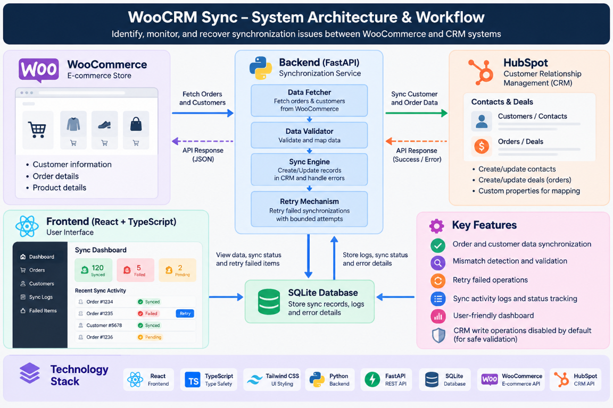
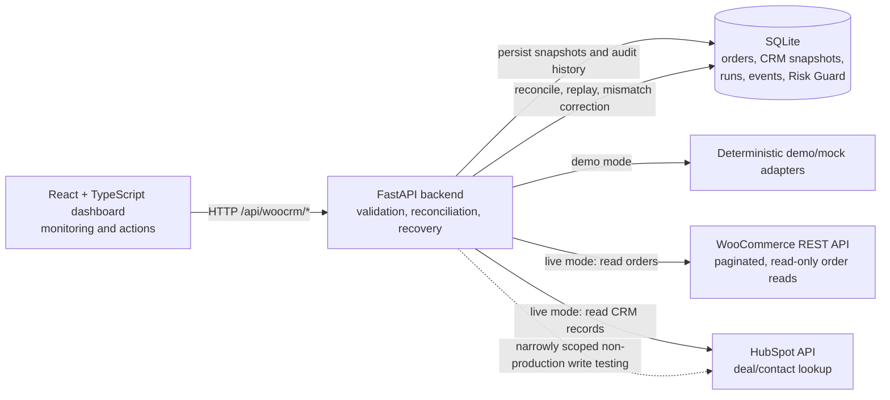

# WooCRM Sync

> **Reliable WooCommerce–CRM synchronization, reconciliation, and recovery.**

WooCRM Sync is a hackathon MVP for investigating whether WooCommerce orders and
CRM records agree. It combines a FastAPI service, a React dashboard, deterministic
demo data, dataset-scoped imports, and backend-only live connectors so that
sync failures are visible, reviewable, and recoverable instead of silently
disappearing between systems.

[](https://www.python.org/)
[](https://react.dev/)
[](https://www.typescriptlang.org/)
[](https://fastapi.tiangolo.com/)
[](https://vite.dev/)
[](https://sqlite.org/)
[](#project-status)

## Contents

- [Project status](#project-status)
- [Why WooCRM Sync](#why-woocrm-sync)
- [Project Resources & Documentation](#project-resources--documentation)
- [How it works](#how-it-works)
- [Features](#features)
- [Application tour](#application-tour)
- [Technology stack](#technology-stack)
- [Quick start](#quick-start)
- [Configuration and security](#configuration-and-security)
- [API surface](#api-surface)
- [Testing](#testing)
- [Production deployment](#production-deployment)
- [Known limitations](#known-limitations)
- [Roadmap](#roadmap)
- [Contributing](#contributing)

## Project status

**Hackathon MVP — active development.** The deterministic demo flow and automated
backend/frontend verification are implemented. Live WooCommerce and HubSpot
behavior still needs validation against dedicated real accounts before any
non-production write test. Production CRM writes are permanently unavailable.

## Why WooCRM Sync

### The problem

- Customer and order data can become inconsistent across integrated systems.
- A synchronization request can fail, partially complete, or leave a record missing.
- Manual investigation and correction take time, especially when the failure history
  is difficult to reconstruct.

### Our approach

WooCRM Sync presents a dashboard for synchronization health, order-level
investigation, customer identity checks, imports, connection checks, and recovery
actions. The backend stores reconciliation runs and order events in SQLite, and
the demo dataset deliberately includes missing records, mismatches, recoverable
errors, blocked actions, and verified recovery scenarios.

> The goal is not just to move data between systems, but to make synchronization
> failures visible and recoverable.

## Project Resources & Documentation

- [Project Resource 1](https://drive.google.com/file/d/1n0MM7QxxBwMM0zLQbOFe997-XzlpXcNb/view?usp=drive_link)
- [Project Resource 2](https://drive.google.com/file/d/15O0uC6j70yfXDrCZtVeRkIJd6o6vChyb/view?usp=drive_link)

## How it works





The live connectors are backend-only: provider credentials never belong in the
frontend. In production, the service requires explicit environment configuration,
authentication, exact CORS origins, persistent storage, and a single backend
instance. `CRM_WRITE_ENABLED` remains `false` by default, and production code
does not permit CRM writes even if it is set to `true`.

## Features

| Capability | What is implemented |
| --- | --- |
| Reconciliation | Compares eligible `processing` and `completed` WooCommerce orders with CRM records and reports `SYNCED`, `MISSING`, `MISMATCH`, `ERROR`, or `NOT_ELIGIBLE`. |
| Recovery workflow | Investigates an order, replays recoverable work, or requests a mismatch update, then performs a fresh comparison before reporting verification. |
| Persistent history | Stores dataset-scoped sync runs, reconciliation results, action events, and order history in SQLite. |
| Demo and live modes | Uses deterministic local records in demo mode; live mode reads paginated WooCommerce orders and HubSpot CRM data through the backend. |
| Imports | Accepts validated JSON or CSV WooCommerce and mock-CRM records, with dataset isolation, idempotent re-imports, and configurable size/record limits. |
| Risk Guard | Evaluates proposed CRM changes for large total changes, currency changes, batch size, and stale or untrustworthy timestamps; approvals are tied to the evaluated record fingerprint. |
| Dashboard workflows | Provides Dashboard, Orders, Customers, Import Data, Risk Guard, Settings, order investigation, filtering, and global search views. |
| Connection checks | Settings can verify demo availability or live WooCommerce/HubSpot connectivity without exposing provider credentials to the browser. |
| Safe defaults | Demo authentication is disabled by default; production requires bearer authentication; CRM writes are disabled and permanently blocked in production. |

## Application tour

The repository includes product branding and a sample import file, but it does
not currently include captured application screenshots. Suggested screenshots
for a future project gallery are:

1. Dashboard with reconciliation counts and sync health.
2. Orders or order investigation view showing mismatch/error history.
3. Risk Guard review screen showing a proposed action and its outcome.
4. Settings and Import Data views showing safe configuration and dataset workflows.

To capture them locally, start the backend and frontend from
[Quick start](#quick-start), load `http://localhost:5173/woocrm/`, use fictional
demo data only, and save reviewed images under a documentation asset directory.
A short GIF can be added later by recording: dashboard → order investigation →
replay or mismatch review → refreshed verified state.

## Technology stack

| Technology | Role |
| --- | --- |
| React 19 | Frontend user interface and page workflows |
| TypeScript 7 | Frontend types and build-time checking |
| Vite 6 | Frontend development server and production build |
| Custom CSS | Current frontend styling; Tailwind CSS is not part of the current build |
| FastAPI | Backend HTTP API and startup validation |
| Python 3.12+ | Backend implementation, connectors, validation, and reconciliation |
| SQLite | Single-instance persistence for snapshots, runs, events, and Risk Guard |
| WooCommerce REST API | Live, paginated, read-only order source |
| HubSpot API | Live CRM deal/contact lookup and narrowly scoped non-production write testing |
| pytest / GitHub Actions | Backend tests and repository verification |

## Quick start

### Prerequisites

- Python 3.12 or newer
- Node.js 20 or newer
- npm

### 1. Clone and configure the backend

```powershell
git clone https://github.com/skylabarbosa/WooCRM-Sync.git
cd WooCRM-Sync
Copy-Item backend\.env.example backend\.env
```

The backend reads environment variables from the process environment. For local
PowerShell development, load the values in your shell or use a local environment
loader; never commit the file or real credentials. The safe demo configuration
is:

```powershell
$env:APP_ENV = "demo"
$env:INTEGRATION_MODE = "demo"
$env:CRM_PROVIDER = "mock"
$env:CRM_WRITE_ENABLED = "false"
$env:CORS_ORIGINS = "http://localhost:5173,http://127.0.0.1:5173"
```

Create and start the virtual environment:

```powershell
cd backend
python -m venv .venv
.\.venv\Scripts\Activate.ps1
pip install -r requirements.txt
$env:PYTHONPATH = "."
uvicorn app.main:app --reload --port 8000
```

The API is available at `http://localhost:8000`. Health and readiness checks
are `GET /api/woocrm/health` and `GET /api/woocrm/ready`. Demo startup creates
the default database at `backend/woocrm.db` unless `DATABASE_PATH` is set.

### 2. Start the frontend

Open a second PowerShell window at the repository root:

```powershell
cd frontend
npm ci
npm run dev
```

Open <http://localhost:5173/woocrm/>. The Vite development client defaults to
`http://localhost:8000` when `VITE_API_URL` is absent. For another backend URL,
copy [frontend/.env.example](frontend/.env.example) to
`frontend/.env.local` and set `VITE_API_URL` to the URL only, without credentials
or provider keys.

### 3. Try the demo

The default dataset contains twelve deterministic fictional orders and seeded
reconciliation outcomes, including synced, missing, recoverable error, total
mismatch, currency mismatch, newer-CRM, manual-review, blocked, incomplete,
previously resolved, and failed-then-verified recovery scenarios. Use the
Dashboard and Orders pages to inspect them; use Settings to test the local
connection and switch datasets.

## Configuration and security

Copy [backend/.env.example](backend/.env.example) for the complete variable
list. The main settings are:

| Variable | Purpose | Safe example |
| --- | --- | --- |
| `APP_ENV` | Explicit runtime environment; startup accepts only `demo` or `production`. | `demo` |
| `DATABASE_PATH` | SQLite database location; production requires an absolute persistent path. | `./woocrm.db` |
| `AUTH_TOKEN_SECRET` | Signs one-hour production bearer tokens; production requires at least 32 bytes. | `<secret-manager-value>` |
| `AUTH_USERS_JSON` | Production users with username, role, and PBKDF2-SHA256 password hash using at least 600,000 iterations. | `[]` locally |
| `OPERATOR_NAME` | Server-side identity recorded for approvals and audit events. | `operator` |
| `CORS_ORIGINS` | Comma-separated allowed frontend origins. | `http://localhost:5173` |
| `DEMO_RESET_ENABLED` | Controls the demo reset endpoint; defaults true in demo and false in production. | `true` locally |
| `MAX_IMPORT_BYTES` / `MAX_IMPORT_RECORDS` | Import limits; defaults are 10 MB and 5,000 records. | `10485760` / `5000` |
| `INTEGRATION_MODE` | Selects `demo` or `live` connector behavior. | `demo` |
| `CRM_PROVIDER` | Selects `mock` or `hubspot`. | `mock` |
| `CRM_WRITE_ENABLED` | Enables only explicitly configured non-production write testing; production always blocks writes. | `false` |
| `CONNECTOR_MAX_ATTEMPTS` | Bounded retry attempts for transient connector failures, from 1 to 5. | `3` |
| `WOOCOMMERCE_STORE_URL` | WooCommerce store base URL. | `<store-url>` |
| `WOOCOMMERCE_CONSUMER_KEY` / `WOOCOMMERCE_CONSUMER_SECRET` | WooCommerce REST credentials for live reads. | `<secret-manager-value>` |
| `HUBSPOT_ACCESS_TOKEN` | HubSpot private-app token for live CRM checks. | `<secret-manager-value>` |
| `HUBSPOT_*_PROPERTY` | HubSpot deal property mapping for order ID, email, total, currency, and status. | See `backend/.env.example` |
| `VITE_API_URL` | Frontend API base URL; build-time and public. | `http://localhost:8000` |

Security rules:

- Never commit real credentials, bearer tokens, customer data, databases, or backups.
- `VITE_*` variables are public in the browser bundle and must never contain secrets.
- Production requires a strong `AUTH_TOKEN_SECRET`, configured users, exact HTTPS
  CORS origins, `APP_ENV=production`, `INTEGRATION_MODE=live`, and
  `CRM_PROVIDER=hubspot`.
- Production authentication protects reads and mutations by role: viewers can
  read, operators can mutate, and admins can reset demo data where enabled.
- SQLite is single-instance storage. Run one backend against a persistent disk,
  back up the configured database before upgrades or operational changes, and
  consider PostgreSQL as a future migration if multiple instances are required.

### Live connector notes

Set `INTEGRATION_MODE=live` and `CRM_PROVIDER=hubspot`, then use **Settings →
Test connection**. WooCommerce reads are paginated and read-only; its API key
needs order Read access, not Write access. HubSpot deal lookup expects the
configured order ID, status, and email properties, and a private-app token
with `crm.objects.deals.read` is sufficient for read-only connection/search
checks. The adapter does not create or update contacts, delete records, bulk
write, or support arbitrary CRM object types.

## API surface

All routes are namespaced under `/api/woocrm/`. The most important endpoints are:

| Area | Endpoints |
| --- | --- |
| Health and auth | `GET /health`, `GET /ready`, `POST /auth/login` |
| Dashboard and data | `GET /config`, `GET /datasets`, `GET /dashboard`, `GET /orders/{id}/history` |
| Operations | `POST /sync`, `POST /reconcile`, `POST /reset`, `POST /failure` |
| Imports | `POST /import/orders`, `POST /import/crm-orders` |
| Recovery | `POST /orders/{id}/replay`, `POST /orders/{id}/update`, `POST /orders/{id}/mismatch` |
| Risk Guard | `GET /risk-guard/evaluations`, `POST /risk-guard/batch`, `GET/PUT /risk-guard/settings`, approval and rejection endpoints |
| Integrations | `POST /test-connection` |

Import endpoints accept a JSON array, `{ "records": [...] }`, or CSV. WooCommerce
records use `id`, `customer_email`, `customer_name`, `total`, `currency`,
`status`, and `created_at`. Mock CRM records use `order_id`, `email`, `name`,
`total`, `currency`, `status` (`SYNCED` or `ERROR`), and `order_status`.
Reconcile and inspect an imported dataset with:

```text
POST /api/woocrm/reconcile?dataset=my-dataset
GET  /api/woocrm/dashboard?dataset=my-dataset
```

## Testing

Run the backend suite:

```powershell
cd backend
$env:PYTHONPATH = "."
pytest -q
```

Build the frontend:

```powershell
cd frontend
npm ci
npm run build
```

GitHub Actions also runs repository secret scanning, `pip-audit`, backend tests,
`npm audit --audit-level=high`, the frontend build, and whitespace checks on
pushes and pull requests. Automated connector tests use mocked HTTP responses;
they do not verify behavior against live WooCommerce or HubSpot accounts.

## Production deployment

### Render backend web service

1. Create a Web Service with root directory `backend`.
2. Use build command `pip install -r requirements.txt` and start command
   `uvicorn app.main:app --host 0.0.0.0 --port $PORT`.
3. Attach a persistent disk mounted at `/var/data`, set
   `DATABASE_PATH=/var/data/woocrm.db`, and keep one backend instance because
   SQLite is not shared across instances.
4. Set `APP_ENV=production`, `INTEGRATION_MODE=live`, `CRM_PROVIDER=hubspot`,
   exact HTTPS `CORS_ORIGINS`, `DEMO_RESET_ENABLED=false`, and
   `CRM_WRITE_ENABLED=false`.
5. Add `AUTH_TOKEN_SECRET`, `AUTH_USERS_JSON`, and connector credentials as
   Render environment variables or secrets. Never put real values in Git.
6. Set the health check path to `/api/woocrm/health`; verify `/api/woocrm/ready`
   returns HTTP 200 after startup.

### Render frontend static site

1. Create a Static Site with root directory `frontend`, build command
   `npm ci && npm run build`, and publish directory `dist`.
2. Set build-time `VITE_API_URL` to the deployed backend URL without a trailing
   slash. It must contain only a URL, never credentials, tokens, or provider keys.
3. Add a rewrite from `/*` to `/index.html` so refreshing client-side routes such
   as `/woocrm/orders` and `/woocrm/settings` serves the SPA entry point.

### SQLite backup and restore

Keep the database and backups outside Git, owned by the backend service account,
with directory mode `0700` and file mode `0600`, on encrypted storage where
possible. A consistent Linux backup can be made while the service is running:

```bash
mkdir -p /var/data/backups
chmod 700 /var/data/backups
sqlite3 /var/data/woocrm.db \
  ".backup '/var/data/backups/woocrm-$(date -u +%Y%m%dT%H%M%SZ).db'"
chmod 600 /var/data/backups/woocrm-*.db
sha256sum /var/data/backups/woocrm-*.db > /var/data/backups/SHA256SUMS
```

Retain at least daily backups for 14 days and weekly backups for 12 weeks,
including one recent copy in a separate failure domain. Monitor backup success,
size, and available disk space. At least quarterly, rehearse a restore in an
isolated staging directory: verify the checksum, restore to a new database path,
run `PRAGMA integrity_check;`, start one staging instance, verify `/health` and
`/ready`, sign in, confirm order history and audit events, and exercise only
read-only connector checks. Keep `CRM_WRITE_ENABLED=false`.

For an actual restore, stop the backend, preserve the current database for
forensics, copy the verified backup into the configured path, reapply ownership
and permissions, and perform the same integrity and read-only smoke checks before
allowing traffic. Do not use reset or seed commands as a restore procedure.

## Known limitations

- Live WooCommerce and HubSpot behavior has not been verified against real accounts.
- There are no database migrations.
- Live search-then-create can race under concurrent requests.
- Production CRM writes are unavailable; use dedicated non-production accounts
  and explicit approval for any write testing.
- SQLite supports one backend instance per database; it is not a multi-instance
  deployment store.

## Roadmap

Future work, not current product claims:

- Improve retry and connector-failure observability.
- Add stronger protection for concurrent search-then-create operations.
- Expand integration tests against isolated provider test accounts.
- Add additional CRM connectors.
- Introduce a migration path for a multi-instance database deployment.

## Contributing

Bug reports and focused feature proposals are welcome through the repository's
GitHub Issues. When contributing, include reproducible steps, relevant logs
with credentials redacted, and tests for behavior changes where practical.

Before opening a pull request, run the backend tests, frontend build, and
`git diff --check`. Keep credentials, tokens, customer data, SQLite databases,
and backup artifacts out of commits.
